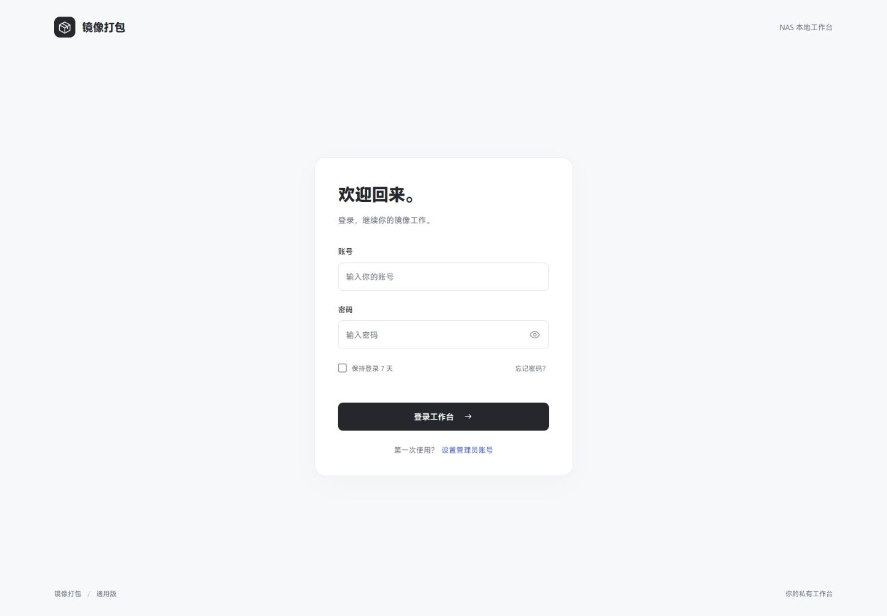
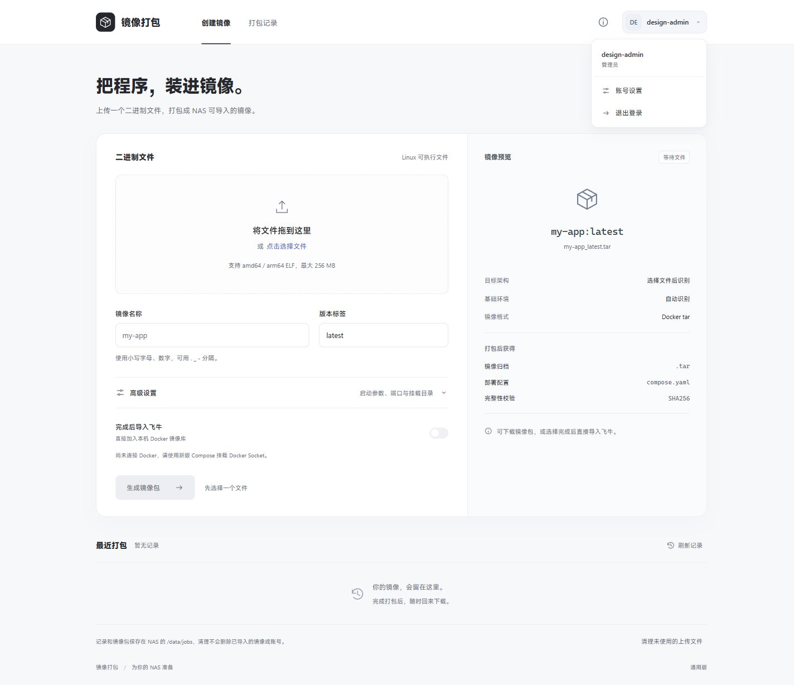

# binpack

面向 NAS 的通用二进制镜像打包工作台。

上传 Linux ELF 二进制，识别架构和基础环境，生成 Docker 镜像包、Compose 与 SHA256 校验文件。支持打包完成后导入本机 Docker 镜像库，以及历史下载与缓存清理。访问需要管理员登录。

## 飞牛 / NAS 部署

公开镜像：`ghcr.io/agonie0v0/binpack:latest`，支持 `linux/amd64` 和 `linux/arm64`。`latest` 指主分支最近通过检查的版本。服务镜像架构与未来上传文件的运行架构是两回事。

在飞牛 Docker 的 Compose 项目中粘贴：

```yaml
services:
  binpack:
    container_name: binpack
    image: ghcr.io/agonie0v0/binpack:latest
    ports:
      - "38627:8088"
    environment:
      DATA_DIR: /data
      COOKIE_SECURE: "0"
    volumes:
      - binpack-data:/data
      - /var/run/docker.sock:/var/run/docker.sock
    restart: unless-stopped

volumes:
  binpack-data:
```

访问 `http://NAS的IP:38627`。从容器日志中的 `FIRST SETUP TOKEN` 取得一次性初始化凭证，设置自己的管理员账号。没有默认密码。更新时重新拉取镜像并重建容器，保留数据卷；命令行为 `docker compose pull && docker compose up -d`。

`container_name: binpack` 固定容器显示名称，可以改成自己的名字。同一 NAS 上的容器名称必须唯一；修改后重新部署 Compose 项目即可生效。

`binpack-data` 是 NAS Docker 管理的数据卷，实际位置可用 `docker volume inspect <项目名>_binpack-data` 查看。也可以改为 `/vol1/1000/docker/binpack/data:/data` 这样的专用绑定目录，路径按实际 NAS 修改。启动器会将数据目录及已有账号文件的所有者设为 `10001:10001`，目录权限设为 `700`、账号文件设为 `600`，然后以普通用户运行服务。它不会递归修改目录内其他文件。上传源文件在 `/data/uploads`，历史、镜像包和部署配置在 `/data/jobs`。界面可以清理单条打包记录、归档和未使用的源文件；账号数据库与已导入的 Docker 镜像不在清理范围。完成打包后会自动移除该上传文件的第二份源文件副本。默认单文件最大 256 MB、缓存容量上限 10 GB，空间不足时需清理后重试。

容器入口以 root 准备数据目录，随后切换为 UID/GID `10001:10001` 运行服务，仅保留挂载的 Docker Socket 所属组以便访问，无需特权模式。如果手动设置 Compose 的 `user: "10001:10001"`，则跳过自动权限修复，需要提前赋予目录和账号文件的读写权限。环境变量 `PORT` 可修改容器监听端口，端口映射需同步修改。

若日志出现 `unable to open database file` 或 `Cannot prepare data directory`，请重新拉取最新镜像并重建容器，保留原数据卷。目录必须可写，磁盘需要有剩余空间；只读挂载或 NAS ACL 拒绝访问时需要在 NAS 上调整。不要删除账号数据库或数据卷来修复权限。

源码内的 [compose.yaml](compose.yaml) 可直接用于 NAS 部署：`docker compose up -d`。如需从源码构建，执行 `docker build -t binpack:local .`。

## 自动识别与打包

- 文件上传后静态分析 ELF 程序头，识别 amd64 / arm64、动态链接器和推荐基础环境。
- 同架构程序会在临时容器中执行 `--help`。容器无网络、只读根文件系统、无主机目录挂载，以 UID 65534 运行，限制 CPU、128 MB 内存、64 个进程和约 6 秒运行时间。程序不能访问 Docker Socket；只读入帮助信息，不进行正常服务启动。
- 仅提取帮助中明确声明的默认端口、数据目录；不会把任意数字或缓存路径当作配置。结果显示依据和支持的参数，不覆盖你手动填写的内容。无法确定时留空，启动参数默认保持程序原生行为。
- 自动基础环境使用 `alpine:3.23`（静态 / musl）或 `debian:trixie-slim`（glibc）。首次使用需联网获取基础镜像。跨架构可打包，跳过帮助信息运行；需要额外资源、自定义动态库或特殊系统依赖的程序需自行准备，本版仅接收一个可执行文件。
- 生成镜像时不会执行上传的程序。镜像通过 JSON 形式的 ENTRYPOINT/CMD 启动，启动参数不经过 shell。
- 未勾选导入时只保留可下载归档，内部构建标签会清除；勾选“完成后导入飞牛”或点击记录中的“导入飞牛”，会使用 Docker Engine 加载归档并核对内容层、架构和启动配置。同名标签会更新，不会自动创建或启动容器。

**使用已部署的旧版本时，必须同时更新 Compose，增加 Docker Socket 挂载，再重新拉取和重建。** 仅更新镜像不能自动添加挂载。界面会显示 Docker 连接状态，未连接时可以静态分析，打包和导入不可用。

Docker Socket 提供宿主机 Docker 管理权限，权限范围很大；此工具应仅由可信管理员使用。参考 [Docker Socket 安全说明](https://docs.docker.com/engine/security/protect-access/)。不要把 Socket 地址开放到公网 TCP 端口。

生成的应用 Compose 默认把服务端口同号映射到 NAS，部署前可修改左侧宿主机端口以避免占用；填写数据目录时生成独立数据卷。生成后提供的“SHA256 校验”用于验证下载完整性，不代表程序已通过业务运行测试。

## 自动发布

[GitHub Actions](https://github.com/Agonie0v0/binpack/actions/workflows/image.yml) 会在测试通过后发布到 GHCR：

- 推送 `main`：更新 `latest` 和 `preview`，同时保留 `sha-<短提交号>` 镜像。
- 推送 `v*` 标签：发布同名标签，例如 `v0.1.0-preview.1`；`latest` 始终跟随主分支。
- Actions 页面手动运行：发布所选分支的提交标签；选择 `main` 时也更新 `latest` 和 `preview`。
- Pull Request：执行测试与容器运行检查，不发布镜像。

流程使用 GitHub 内置的 `GITHUB_TOKEN`，无需配置 Docker Hub 密码。Actions 依赖固定到提交 SHA，Dependabot 每月检查更新。发布检查包括服务端鉴权测试、前端逻辑测试、容器内重复鉴权测试、启动健康检查、未登录拦截，NAS 数据目录权限修复、账号保留、重启和只读挂载诊断；另外用静态 C 程序验证真实上传、隔离帮助分析、归档下载、Docker 加载、运行、自动导入及缓存清理。

需要离线导入 NAS 时，在能拉取 GHCR 的 Docker 主机执行（ARM NAS 改为 `linux/arm64`）：

```sh
docker pull --platform linux/amd64 ghcr.io/agonie0v0/binpack:latest
docker save -o binpack-latest-amd64.tar ghcr.io/agonie0v0/binpack:latest
```

将生成的 tar 文件导入飞牛 Docker 镜像。此处导出的是工具本身的镜像。

## 本地运行

使用 Python 3.13 或更高版本，无第三方 Python 依赖：

```sh
python server.py --host 0.0.0.0 --port 8088 --data-dir ./data
```

NAS 容器版把 `DATA_DIR` 设置为 `/data`，并挂载到 NAS 的持久化目录。

第一次打开网页会进入设置管理员页面。从服务启动日志的 `FIRST SETUP TOKEN` 取得一次性初始化凭证，设置自己的账号与密码；没有默认账号密码。初始化完成后，凭证文件自动删除，不能再次创建管理员覆盖原账号。

账号支持 3–32 位英文字母、数字及 `. _ -`，首位为字母或数字。密码支持 12–128 个字符。

## 登录与退出

- 工作台、账号页、打包 API 与下载路由均在服务端鉴权。未登录时页面跳转登录页，接口返回 401。
- 密码使用独立随机盐和 PBKDF2-HMAC-SHA256（600,000 次），不保存明文密码。
- 会话令牌仅通过 HttpOnly、SameSite=Strict Cookie 传递，数据库中也只保存令牌摘要，不使用浏览器 localStorage 保存登录凭证。
- 普通登录浏览器会话有效，服务端最长 24 小时，空闲 8 小时失效。“保持登录 7 天”最长 7 天，空闲 24 小时失效。浏览器的会话恢复行为因浏览器而异，应使用退出按钮主动结束会话。
- 退出使当前会话立即失效；修改或终端重置密码会撤销所有设备的会话。
- 每个直接连接来源在 10 分钟内累计 10 次失败后暂缓 60 秒，成功验证会清零。应用不信任用户可伪造的转发 IP；使用 Lucky 后同一反代的用户共享该限制。
- 写操作校验同源 Origin 与 CSRF 凭证；账号与令牌文件不会由网页服务器提供下载。

密码与会话设计参考：[OWASP 密码存储](https://cheatsheetseries.owasp.org/cheatsheets/Password_Storage_Cheat_Sheet.html)、[OWASP 会话管理](https://cheatsheetseries.owasp.org/cheatsheets/Session_Management_Cheat_Sheet.html)。

## 数据位置与缓存清理边界

账号和会话保存在数据目录中的 `auth.sqlite3`。首次设置前还有私有文件 `setup-token`。打包历史与镜像归档使用独立子目录，**清理打包缓存不能删除账号数据库**。

开发预览使用 `.preview-auth/`，该目录已加入忽略列表，不能随源码或最终镜像分发。

## Lucky 反向代理

工具本身提供 HTTP。由 Lucky 提供外部 HTTPS，转发到工具的 HTTP 端口。部署时设置：

```yaml
environment:
  DATA_DIR: /data
  COOKIE_SECURE: "1"
  PUBLIC_ORIGIN: https://你的工具域名
```

反代保留客户端 Host；`PUBLIC_ORIGIN` 必须是浏览器实际访问的完整源地址，包含非标准端口（如有），不带路径。设置 `COOKIE_SECURE=1` 后通过 HTTPS 访问；直接用 HTTP 登录时浏览器不会发送 Secure Cookie。

第一版使用一个管理员账号，与飞牛系统账号独立，不包含开放注册、邮件找回或多人权限分级。

## 忘记密码

在飞牛容器终端执行：

```sh
python /opt/image-packager/server.py --data-dir /data --reset-password
```

终端会隐藏输入并要求确认新密码，不通过网页或命令行参数传递明文密码。账号数据库不存在时，应按首次初始化流程设置账号。

## 验证

```sh
python -m unittest -v test_auth.py test_packaging.py
node design/verify-preview.mjs
node design/verify-auth-client.mjs
```

鉴权检查覆盖：未登录页面与接口拦截、初始化凭证、并发初始化、密码和令牌不以明文持久化、Cookie 标志、CSRF 与 Origin、非法请求、退出、密码修改撤销所有会话、会话超时、重启保留和失败限流。飞牛部署仍需实机验证。

## 界面





手机布局见 [工作台手机截图](design/workbench-mobile.png)。截图使用临时测试账号，本地未挂载 Docker Socket。
